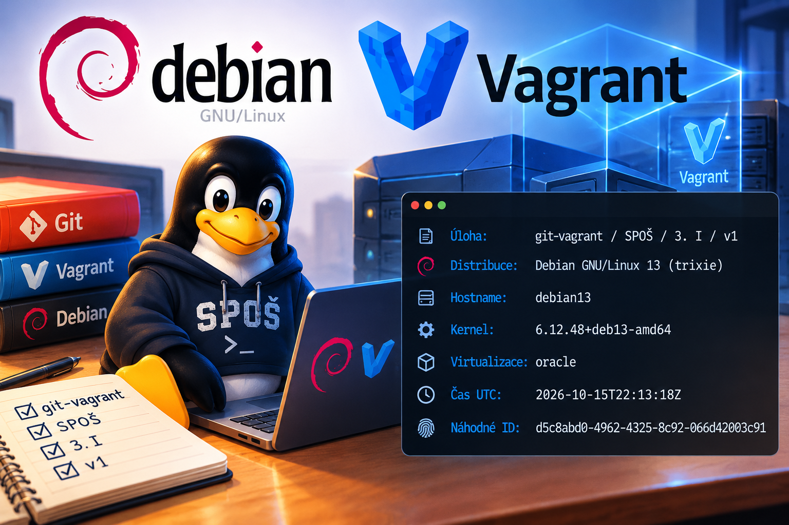
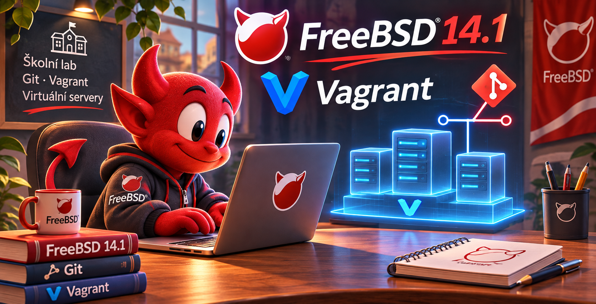
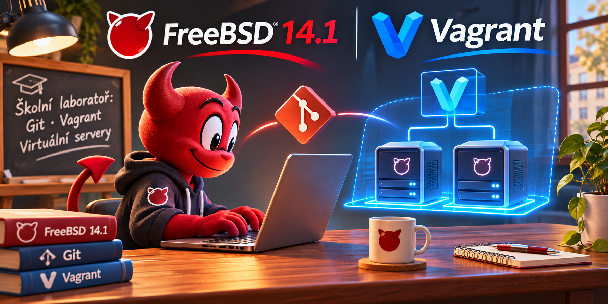

# Galerie virtuálních serverů

Obrázky jednotlivých serverů. Kliknutím na název otevřete jejich README.

## [srv01 – bento/debian-13](../srv01/README.md)

## [srv02 – bento/almalinux-10](../srv02/README.md)

## [srv03 – bento/centos-stream-10](../srv03/README.md)

## [srv04 – bento/rockylinux-10](../srv04/README.md)

## [srv05 – bento/fedora-43](../srv05/README.md)

## [srv06 – bento/oraclelinux-10](../srv06/README.md)

## [srv07 – bento/ubuntu-24.04](../srv07/README.md)

## [srv08 – bento/opensuse-leap-15](../srv08/README.md)

## [srv09 – kalilinux/rolling](../srv09/README.md)

## [srv10 – freebsd/FreeBSD-14.1-STABLE](../srv10/README.md)

## [srv11 – freebsd/FreeBSD-14.1-RELEASE](../srv11/README.md)

